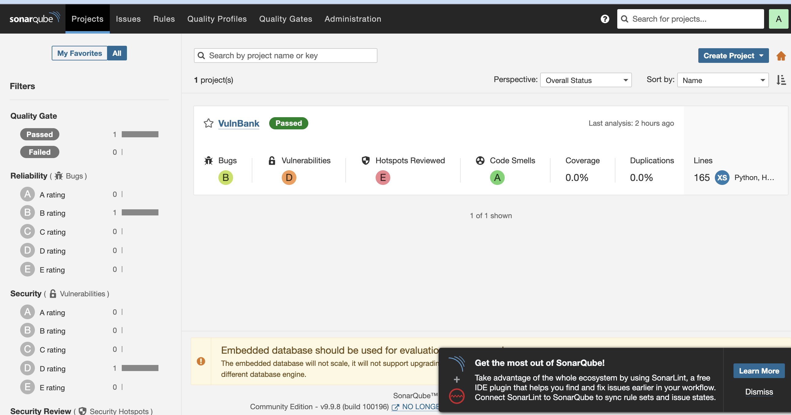
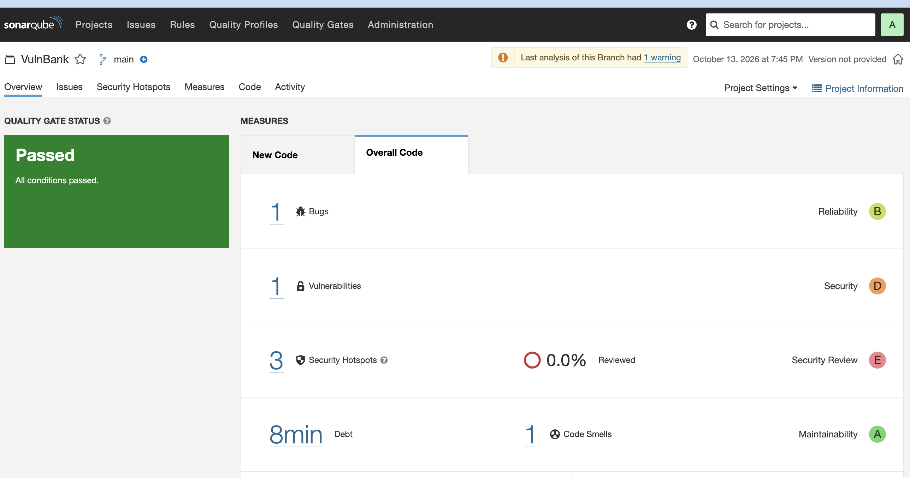
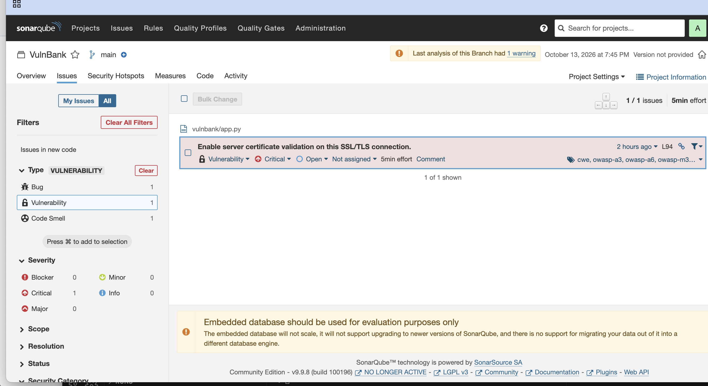
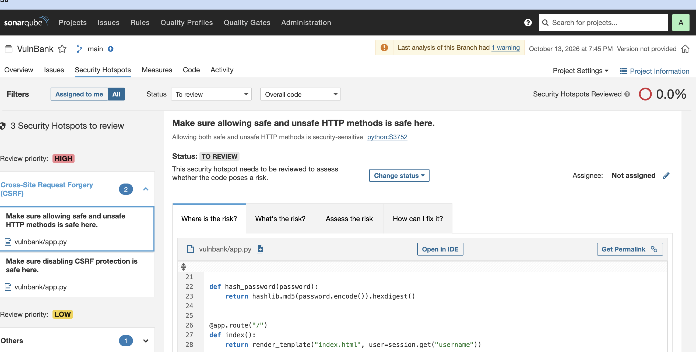
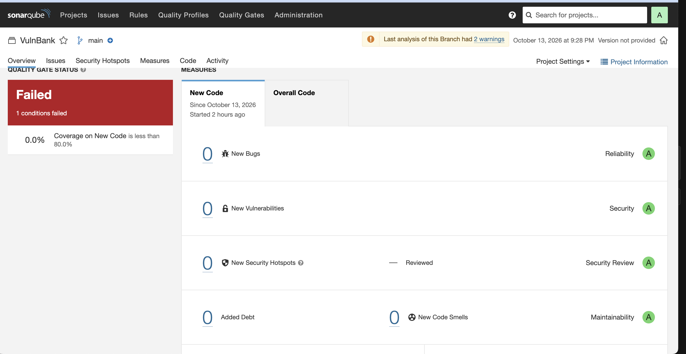

<p align="center">
  
</p>

<h1 align="center">TP 1 : Analyse Statique (SAST) et Sécurité des Dépendances (SCA)</h1>
<h3 align="center">Compte rendu — SAST avec Bandit &amp; SonarQube, SCA avec pip-audit</h3>

<p align="center">
  <b>Réalisé par :</b><br>
  Youssef Khalifa<br>
  Hanine Khemir<br>
  Oussema Said<br>
  Ahmed Amine Bououd
</p>

<p align="center">
  <b>Classe :</b> GL4 — Groupe 1
</p>

<div class="pagebreak"></div>

---

**Dépôt :** https://github.com/HanineKhemir/devsecops-tp1-sast-sca

**Outils :** Docker, Bandit, SonarQube Community 9.9, pip-audit / OSV, Flask, Git

---

## 1. Objectif

Le but du TP est d'appliquer l'approche **shift-left** : trouver et corriger les
failles de sécurité **pendant le développement**, pas après la mise en
production. Corriger tôt coûte moins cher et évite d'exposer l'application.

Nous utilisons deux types d'outils automatiques :

| Type | Ce qu'il vérifie | Outils |
|---|---|---|
| **SAST** | Les failles dans **notre code** | Bandit, SonarQube |
| **SCA** | Les failles connues (CVE) dans **nos dépendances** | pip-audit / OSV |

L'application de test est **VulnBank** : une petite application web Flask que nous
avons écrite avec des failles volontaires. L'historique Git montre la démarche en
trois étapes :

```
baseline    → application vulnérable (avant les scans)
fix(sast)   → correction des failles du code
fix(sca)    → mise à jour des dépendances vulnérables
```

---

## 2. Environnement

- **Application :** Flask + base SQLite. Routes : connexion, consultation de
  comptes, commentaires, export, taux de change.
- **Docker :** l'application et tous les scanners tournent dans des conteneurs —
  rien n'est installé sur le poste.

```bash
docker build -t vulnbank:baseline .
docker run --rm -e HOST=0.0.0.0 -p 5000:5000 vulnbank:baseline
# http://localhost:5000
```

---

## 3. SAST — Analyse statique du code

### 3.1 Comment nous l'avons lancé

**Bandit** (analyseur Python) :

```bash
docker run --rm -v "$PWD":/src -w /src python:3.11-slim \
  sh -c "pip install bandit && bandit -r vulnbank"
```

**SonarQube** (plateforme avec tableau de bord) :

```bash
docker run -d --name sonarqube -p 9000:9000 sonarqube:lts-community
# scan avec sonar-scanner, résultats sur http://localhost:9000
```

### 3.2 Résultat initial : les failles trouvées

Bandit a trouvé **9 failles** dans le code de départ :

| Ligne | Faille | Gravité |
|---|---|---|
| 41, 66 | **Injection SQL** (routes `/login` et `/accounts`) | Medium |
| 88 | **Injection de commande** (`os.system`) | High |
| 94 | Validation du certificat TLS désactivée (`verify=False`) | High |
| 23 | Mots de passe hachés en **MD5** | High |
| 100 | Flask lancé avec `debug=True` | High |
| 19 | `yaml.load()` non sécurisé | Medium |
| 11 | Clé secrète écrite en dur dans le code | Low |
| 100 | Écoute sur toutes les interfaces (`0.0.0.0`) | Medium |

SonarQube a trouvé de son côté **1 vulnérabilité** (certificat TLS, ligne 94) et
**3 points à réviser** (MD5 + 2 CSRF).

**Capture 1 — Liste des projets (avant).** VulnBank : sécurité notée **D**.



**Capture 2 — Vue d'ensemble (avant).** 1 vulnérabilité (Security **D**),
3 points à réviser (**E**).



**Capture 3 — Détail de la vulnérabilité (avant).** Certificat TLS non vérifié à
`app.py:94`, gravité **Critical**, étiquettes OWASP.



**Capture 4 — Points à réviser (avant).** 3 hotspots (MD5 + 2 CSRF), 0 % révisé.



> **Point important à présenter :** SonarQube **Community** ne détecte **pas**
> l'injection SQL ni l'injection de commande (il lui manque l'analyse de flux de
> données). C'est **Bandit** qui les trouve. Conclusion : on combine plusieurs
> outils SAST, car aucun ne voit tout.

### 3.3 Les corrections (commit `fix(sast)`)

| Faille | Correction |
|---|---|
| Injection SQL | Requêtes **paramétrées** (`?`) au lieu de concaténer la saisie |
| Injection de commande | On supprime `os.system`; export via l'API SQLite + contrôle du nom de compte |
| Certificat TLS | Vérification réactivée |
| MD5 | Remplacé par `werkzeug` (pbkdf2, avec sel) |
| `yaml.load` | Remplacé par `yaml.safe_load` |
| Clé secrète en dur | Lue depuis une variable d'environnement |
| `debug=True` | Désactivé par défaut |

Exemple — correction de l'injection SQL dans `/login` :

```python
# AVANT : la saisie de l'utilisateur devient directement du SQL
query = f"SELECT ... WHERE username = '{username}' AND password = '{password}'"

# APRÈS : la saisie est un paramètre, jamais du code SQL
conn.execute("SELECT ... WHERE username = ?", (username,))
```

### 3.4 Résultat après correction

- **Bandit : 9 → 0 faille.**
- **SonarQube : Security D → A, 0 vulnérabilité.**

**Capture 5 — Après correction.** Security **A**, **0 vulnérabilité**, 0 bug,
0 point à réviser.



> **À dire pendant la démo :** le bandeau « Quality Gate : Failed » vient
> **uniquement** de la couverture de tests (0 %, car il n'y a pas de tests dans ce
> TP) — **pas** de la sécurité. Toutes les notes de sécurité sont **A**.

Vérification concrète que l'injection SQL ne marche plus :

```bash
curl -X POST localhost:5000/login --data-urlencode "username=x' OR '1'='1" --data "password=z"
# AVANT : connexion réussie    APRÈS : HTTP 401 (rejeté)
```

---

## 4. SCA — Sécurité des dépendances

### 4.1 Comment nous l'avons lancé

```bash
pip-audit -r requirements.txt   # compare chaque dépendance à la base de CVE (OSV)
```

> OWASP Dependency-Check (cité dans le sujet) est fait pour Java et détecte mal
> les paquets Python. **pip-audit / OSV** est le bon outil pour `requirements.txt`.

### 4.2 Résultat initial : les dépendances vulnérables

**7 paquets vulnérables, 44 CVE** au total. Les versions étaient volontairement
anciennes :

| Paquet | Version | CVE la plus grave |
|---|---|---|
| **Jinja2** | 2.10 | **CVE-2019-10906** — évasion du bac à sable → exécution de code |
| Werkzeug | 0.14.1 | CVE-2024-34069 — exécution de code via le debugger |
| Flask | 0.12.2 | CVE-2023-30861 — fuite de session via le cache |
| urllib3 | 1.23 | CVE-2019-11236 — injection CRLF |
| requests | 2.19.1 | CVE-2023-32681 — fuite d'un en-tête d'authentification |
| certifi | 2018.11.29 | CVE-2022-23491 — autorités de certification compromises |
| idna | 2.7 | CVE-2024-3651 — déni de service |

### 4.3 Correction et pourquoi la mise à jour est nécessaire

Nous avons mis à jour les paquets vers des versions corrigées (commit
`fix(sca)`), et fait passer l'image de base de **Python 3.9 à 3.11** pour pouvoir
installer les dernières versions :

| Paquet | Avant | Après |
|---|---|---|
| Jinja2 | 2.10 | 3.1.6 |
| Werkzeug | 0.14.1 | 3.1.9 |
| Flask | 0.12.2 | 3.1.3 |
| urllib3 | 1.23 | 2.8.0 |
| requests | 2.19.1 | 2.33.0 |
| certifi | 2018.11.29 | 2024.8.30 |
| idna | 2.7 | 3.15 |

**Exemple détaillé — Jinja2 2.10 (CVE-2019-10906).**
Jinja2 est le moteur de templates de Flask. Dans la version 2.10, un attaquant
qui contrôle un template peut **sortir du bac à sable** (via `str.format_map`) et
atteindre des objets Python, ce qui peut mener à l'**exécution de code**.

**Pourquoi il faut mettre à jour — en trois points simples :**

1. **La faille est publique.** Elle a un numéro de CVE référencé partout. Tout
   attaquant et tout scanner connaissent la version vulnérable.
2. **Le correctif existe déjà.** La version 2.10.1 corrige la faille. Mettre à
   jour est plus sûr et plus rapide que d'écrire un contournement maison.
3. **Le risque vient de la dépendance, pas de notre code.** Même si notre code ne
   fait rien de dangereux, la bibliothèque, elle, expose la faille. La sécurité
   dépend de **toute** la chaîne de dépendances.

### 4.4 Résultat après mise à jour

- **pip-audit : 44 CVE → 0.**
- L'application fonctionne toujours (page d'accueil HTTP 200, connexion OK).

---

## 5. Conclusion

| Mesure | Avant | Après |
|---|---|---|
| Bandit (code) | 9 failles | **0** |
| SonarQube (code) | Security **D** | Security **A** |
| pip-audit (dépendances) | 44 CVE | **0** |

Ce TP montre, concrètement, l'intérêt du **shift-left** :

- Les failles sont trouvées **automatiquement**, avant tout déploiement.
- Les outils sont **complémentaires** : Bandit voit les injections que SonarQube
  Community ne voit pas.
- La SCA n'est **pas un contrôle unique** : de nouvelles CVE sortent chaque
  semaine, donc le scan doit tourner en continu dans la CI/CD.

---

## 6. Glossaire

**SAST (Static Application Security Testing)** — Analyse statique : on lit **notre
code source sans l'exécuter** pour y trouver des failles de programmation
(injection SQL, mauvais hachage...). Outils : Bandit, SonarQube.

**SCA (Software Composition Analysis)** — On vérifie si les **bibliothèques
externes** que l'application utilise (ses dépendances) contiennent des failles
**déjà connues**. On analyse `requirements.txt`, pas le code. Outil : pip-audit.

> En une phrase : **SAST = les failles qu'on a écrites** ; **SCA = les failles
> dans le code des autres qu'on utilise.**

**Shift-left** — Déplacer les contrôles de sécurité **tôt** dans le cycle
(pendant le développement) au lieu de la fin. Corriger tôt coûte moins cher.

**CVE (Common Vulnerabilities and Exposures)** — Numéro public unique attribué à
chaque faille connue (ex. `CVE-2019-10906`), référencé dans des bases publiques.

**OSV** — Base de données de vulnérabilités open source que pip-audit interroge.

**Dépendance** — Bibliothèque externe installée par le projet (Flask, Jinja2...),
listée avec sa version dans `requirements.txt`.

**Injection SQL** — L'attaquant insère du **code SQL** dans un champ ; si l'app le
colle dans sa requête, il contourne la connexion ou lit la base. Correction :
requête paramétrée (la saisie est une donnée, jamais du code).

**Injection de commande** — Idem avec des **commandes système** (`os.system`) :
exécution de commandes sur le serveur.

**XSS (Cross-Site Scripting)** — Injection de **JavaScript** dans une page.
Correction : auto-échappement des templates.

**MD5** — Vieil algorithme de hachage **cassé** pour les mots de passe (trop
rapide à casser). Remplacé par pbkdf2 (lent et salé).

**TLS `verify=False`** — L'app ne vérifiait pas le certificat du serveur distant →
attaque « man-in-the-middle » possible.

**`debug=True`** — Mode debug de Flask ; expose une console qui permet
d'exécuter du code. Interdit en production.

**Vulnerability (SonarQube)** — Faille **confirmée** par l'outil, à corriger.

**Security Hotspot** — Code **« à vérifier par un humain »** ; pas forcément une
faille.

**Quality Gate** — Ensemble de règles à passer. Rouge (« Failed ») ici **à cause
de la couverture de tests (0 %)**, pas de la sécurité.

**Rating A → E** — Note de A (excellent) à E (mauvais). Notre projet : Security
**D → A**.

---

## Annexe — Reproduire les scans

```bash
git clone https://github.com/HanineKhemir/devsecops-tp1-sast-sca
cd devsecops-tp1-sast-sca

git checkout baseline            # état vulnérable (le « avant »)
docker run --rm -v "$PWD":/src -w /src python:3.11-slim \
  sh -c "pip install bandit && bandit -r vulnbank"
docker run --rm -v "$PWD":/src:ro -w /tmp python:3.11-slim \
  sh -c "cp /src/requirements.txt . && pip install pip-audit && pip-audit -r requirements.txt"

git checkout main                # état corrigé (le « après »)
```

Les rapports bruts des scanners sont dans le dossier [`reports/`](reports/).
